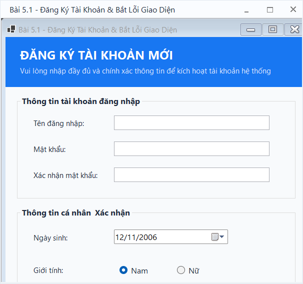
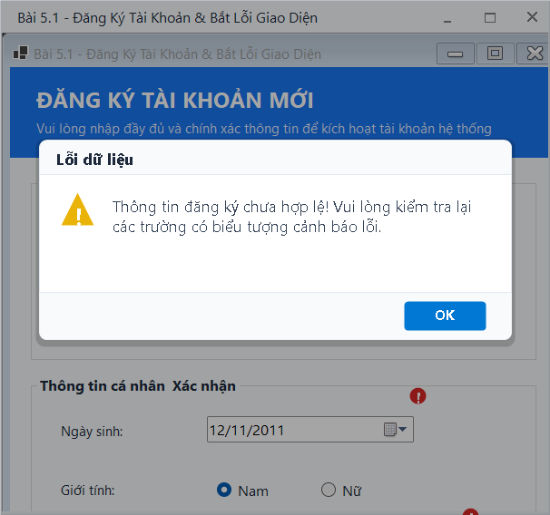
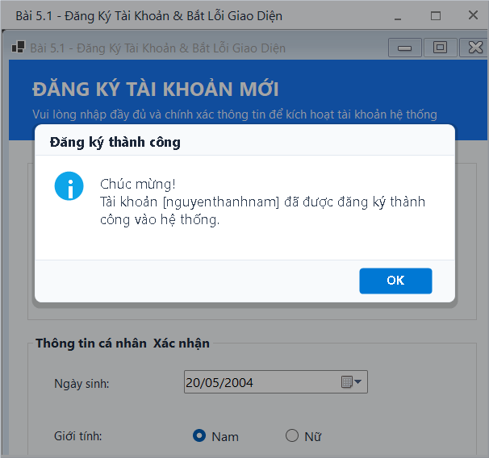

# BÁO CÁO ÔN TẬP THỰC HÀNH WINDOWS FORMS

## THÔNG TIN SINH VIÊN
- **Họ và tên:** [Nguyễn Hải Nam]
- **Mã số sinh viên:** [24810310617]
- **Lớp:** D19CNPM3
- **Tên môn học:** Lập trình C# / Windows Forms (.NET 10)

---

## BÀI TẬP: BÀI 5.1 - FORM ĐĂNG KÝ TÀI KHOẢN VÀ BẮT LỖI GIAO DIỆN (ERRORPROVIDER)

### 1. Mục tiêu và Yêu cầu đề bài
- **Mục tiêu:** Sử dụng các control nhập liệu cơ bản (`TextBox`, `DateTimePicker`, `RadioButton`, `CheckBox`) và kiểm tra tính hợp lệ của dữ liệu đầu vào bằng `ErrorProvider`.
- **Yêu cầu chức năng:**
  1. Khi người dùng nhấn nút **Đăng Ký**, tiến hành kiểm tra:
     - Tên đăng nhập và Mật khẩu không được để trống.
     - Mật khẩu nhập lại phải khớp với Mật khẩu ban đầu.
     - Độ tuổi tính từ Ngày sinh phải $\ge 18$ tuổi.
     - Bắt buộc tích chọn đồng ý Điều khoản dịch vụ.
  2. Bắt lỗi giao diện:
     - Nếu có lỗi nhập liệu, hiển thị biểu tượng cảnh báo `ErrorProvider` (màu đỏ) trực tiếp tại đúng control vi phạm.
     - Bật hộp thoại cảnh báo `MessageBox` nhắc nhở người dùng.
     - Khi tất cả hợp lệ, hiển thị `MessageBox` thông báo thành công kèm thông tin tóm tắt.
  3. Nút **Làm Mới**: Xóa toàn bộ dữ liệu trên form, hủy các cảnh báo lỗi của `ErrorProvider` và đưa con trỏ về ô Tên đăng nhập.

---

### 2. Kết quả Thực hành & Hình ảnh Minh họa

#### 2.1. Giao diện chính ban đầu
Giao diện được thiết kế hiện đại, bố cục rõ ràng với các GroupBox phân định thông tin tài khoản và thông tin cá nhân.

#### 2.2. Kiểm thử bắt lỗi dữ liệu với ErrorProvider
Khi người dùng để trống thông tin, nhập mật khẩu không khớp, chọn ngày sinh dưới 18 tuổi và chưa đồng ý điều khoản, `ErrorProvider` lập tức hiển thị biểu tượng cảnh báo tại các trường vi phạm:

#### 2.3. Đăng ký tài khoản thành công
Khi tất cả thông tin hợp lệ (đủ 18 tuổi, mật khẩu trùng khớp, đã đồng ý điều khoản), hệ thống hiển thị hộp thoại xác nhận đăng ký thành công:

#### 2.4. Chức năng Làm Mới (Reset Form)
Xóa sạch thông tin trên form, xóa lỗi cảnh báo và thiết lập giá trị mặc định sẵn sàng cho lượt nhập mới:

