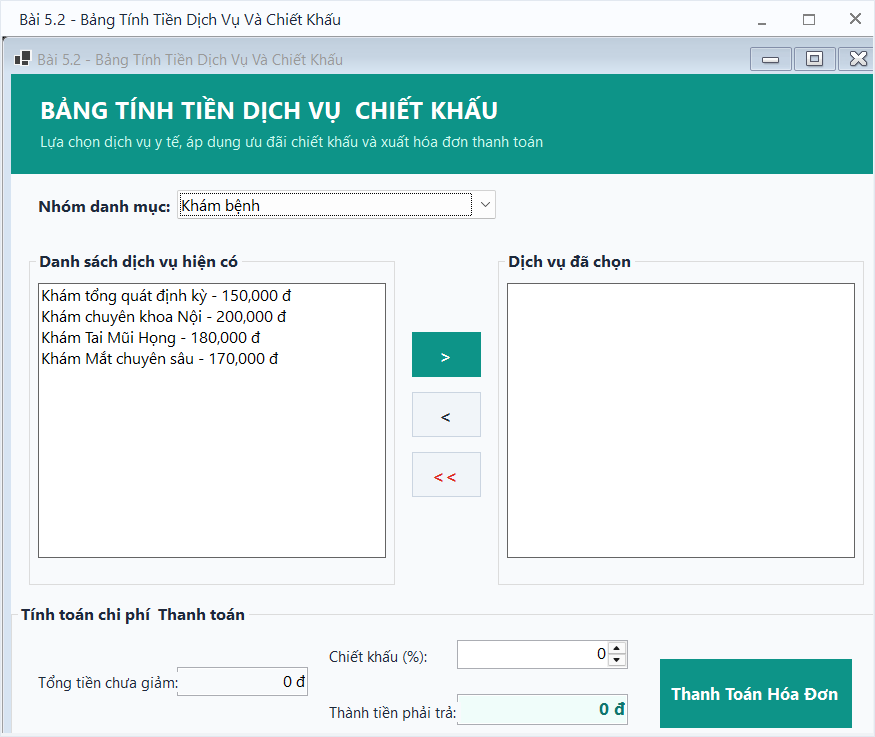
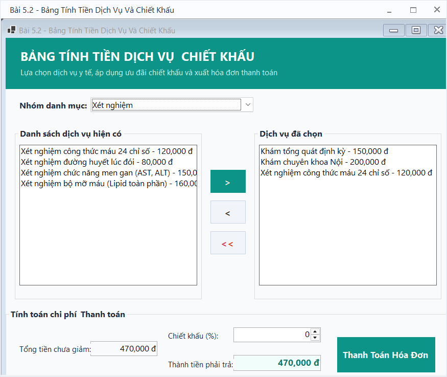
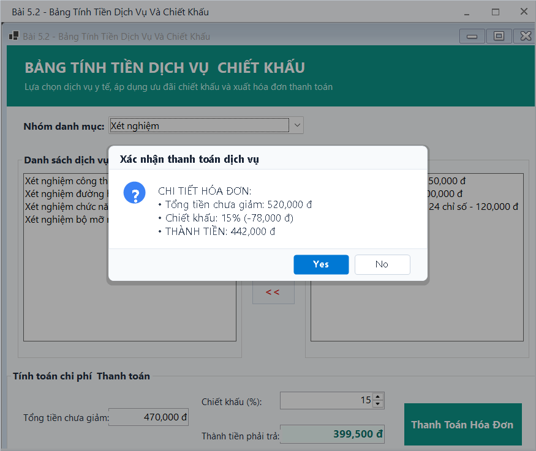
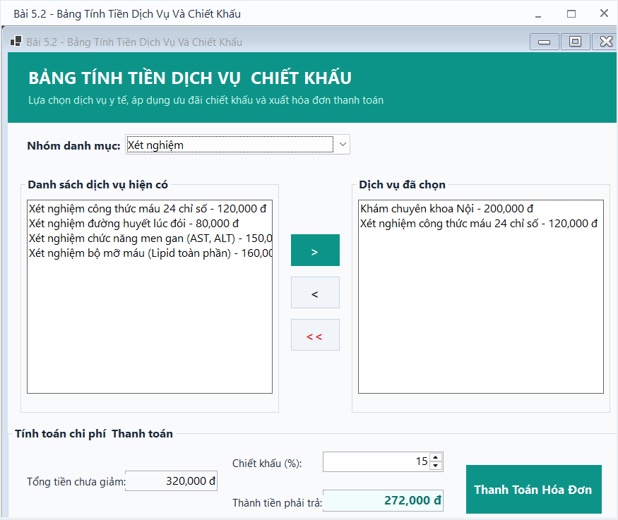

# BÁO CÁO ÔN TẬP THỰC HÀNH WINDOWS FORMS

## THÔNG TIN SINH VIÊN
- **Họ và tên:** [Nguyễn Hải Nam]
- **Mã số sinh viên:** [24810310617]
- **Lớp:** D19CNPM3
- **Tên môn học:** Lập trình C# / Windows Forms (.NET 10)

---

## BÀI TẬP: BÀI 5.2 - BẢNG TÍNH TIỀN DỊCH VỤ VÀ CHIẾT KHẤU ĐƠN HÀNG (LISTBOX & COMBOBOX)

### 1. Mục tiêu và Yêu cầu đề bài
- **Mục tiêu:** Quản lý danh sách phần tử động bằng `ListBox` và `ComboBox`, thực hiện tính toán tổng tiền và áp dụng tỷ lệ chiết khấu giảm giá.
- **Yêu cầu chức năng:**
  1. Khi thay đổi nhóm dịch vụ trên `ComboBox` (`cboCategory`), tự động nạp danh sách dịch vụ tương ứng vào `lstAvailableServices`.
  2. Khi nhấn nút `>` (`btnSelect`) hoặc Double Click vào một item trong `lstAvailableServices`, dịch vụ đó sẽ được chuyển sang `lstSelectedServices`.
  3. Khi nhấn nút `<` (`btnRemove`) hoặc Double Click vào item đã chọn, xóa dịch vụ đó khỏi danh sách chọn. Nút `<<` (`btnClearAll`) cho phép xóa toàn bộ dịch vụ đã chọn sau khi xác nhận.
  4. Tự động tính toán lại:
     - Tổng tiền chưa giảm = Tổng đơn giá các dịch vụ trong danh sách chọn.
     - Số tiền chiết khấu = Tổng tiền $\times$ Tỷ lệ chiết khấu (%).
     - Thành tiền thanh toán = Tổng tiền $-$ Số tiền chiết khấu.
  5. Nút **Thanh Toán**: Hiển thị bảng kê chi tiết hóa đơn và yêu cầu xác nhận trước khi hoàn tất giao dịch.

---

### 2. Kết quả Thực hành & Hình ảnh Minh họa

#### 2.1. Giao diện chính ban đầu
Bố cục 2 danh sách song song, thanh điều hướng ở giữa và khu vực tính tiền ở chân form.

#### 2.2. Lựa chọn nhóm dịch vụ
Khi chuyển đổi danh mục trong ComboBox sang "Xét nghiệm", danh sách dịch vụ xét nghiệm lập tức được nạp vào bảng bên trái:

#### 2.3. Thêm dịch vụ vào đơn hàng
Người dùng chọn dịch vụ và nhấn nút `>` (hoặc nhấp đúp) để đưa dịch vụ sang danh sách đã chọn, tổng tiền được tính tự động:

#### 2.4. Áp dụng tỷ lệ chiết khấu & Xác nhận thanh toán
Khi thiết lập tỷ lệ chiết khấu 15%, hệ thống tính toán ngay lập tức số tiền giảm trừ và hiển thị hộp thoại xác nhận chi tiết hóa đơn thanh toán:

#### 2.5. Xóa bớt dịch vụ khỏi danh sách chọn
Thao tác xóa bớt dịch vụ được chọn bằng nút `<` và hệ thống tự động cập nhật lại tổng tiền:

