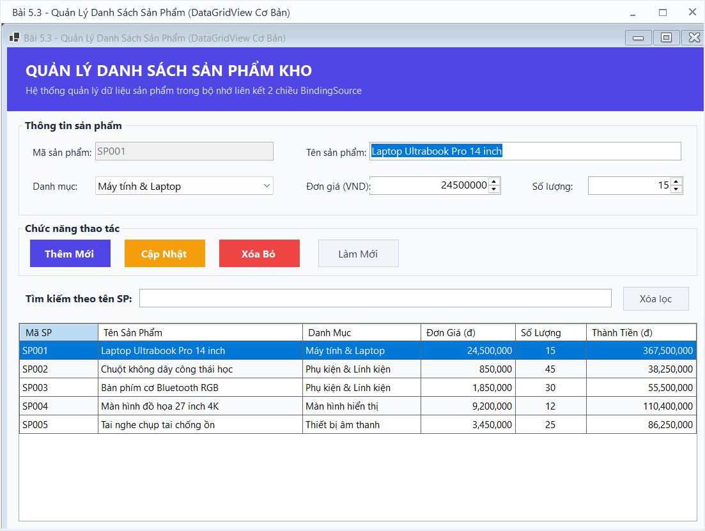
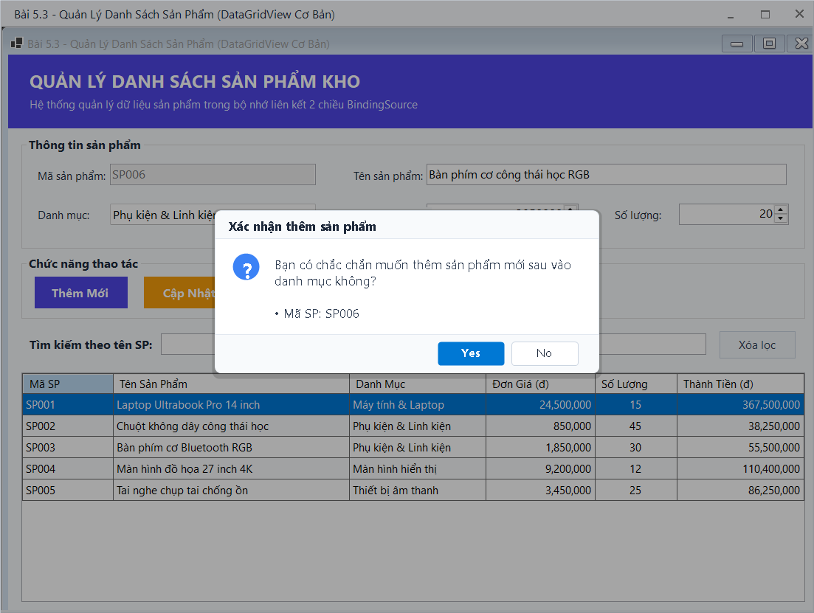
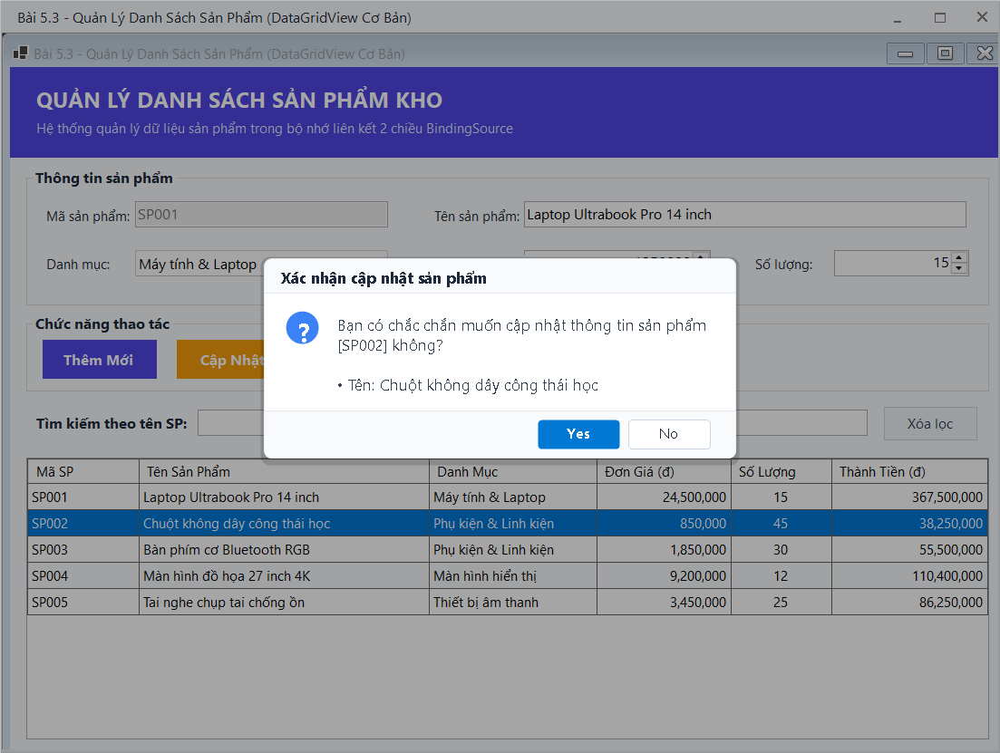
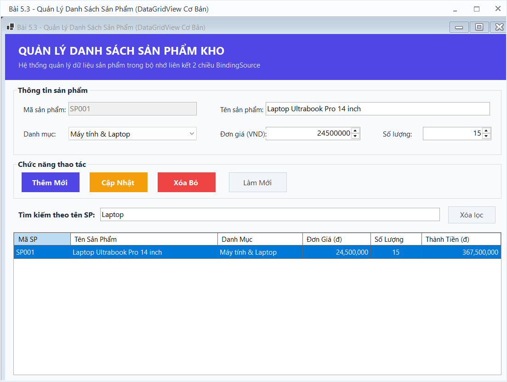
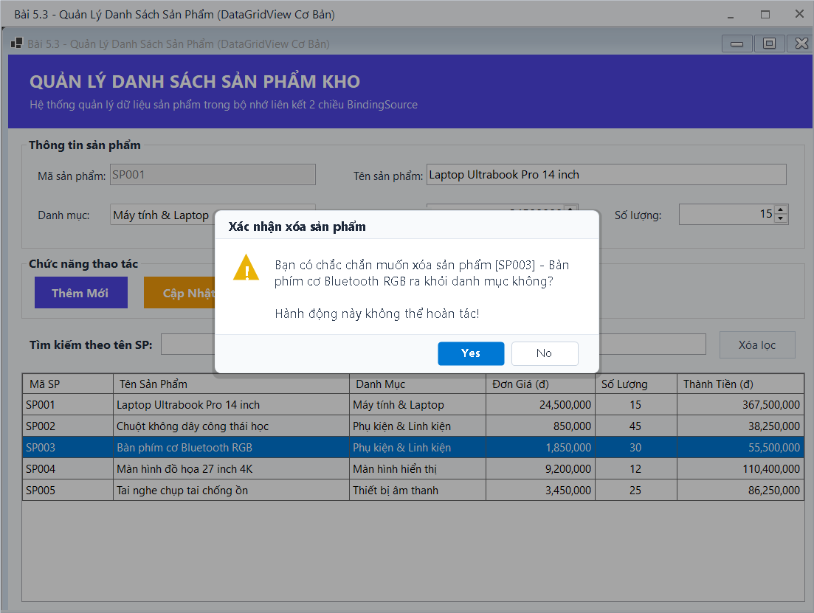
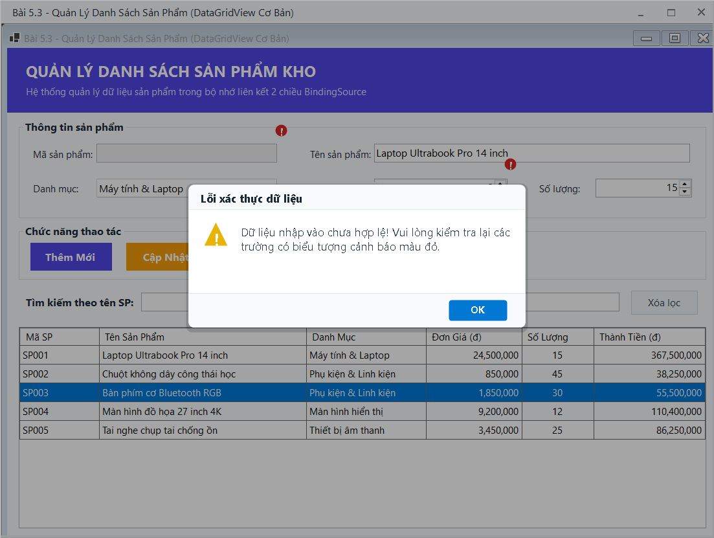

# BÁO CÁO ÔN TẬP THỰC HÀNH WINDOWS FORMS

## THÔNG TIN SINH VIÊN
- **Họ và tên:** [Nguyễn Hải Nam]
- **Mã số sinh viên:** [24810310617]
- **Lớp:** D19CNPM3
- **Tên môn học:** Lập trình C# / Windows Forms (.NET 10)

---

## BÀI TẬP: BÀI 5.3 - FORM QUẢN LÝ DANH SÁCH SẢN PHẨM TRONG BỘ NHỚ (DATAGRIDVIEW CƠ BẢN)

### 1. Mục tiêu và Yêu cầu đề bài
- **Mục tiêu:** Định nghĩa Lớp (Class) đối tượng `Product` triển khai `INotifyPropertyChanged`, sử dụng `BindingList<Product>` và `BindingSource` làm dữ liệu nguồn hiển thị và tương tác 2 chiều trên `DataGridView`.
- **Yêu cầu chức năng:**
  1. Xây dựng lớp `Product` với các thuộc tính: `ProductId`, `ProductName`, `UnitPrice`, `Quantity`, `Category`, `TotalAmount`.
  2. Nút **Thêm Mới**: Kiểm tra dữ liệu hợp lệ (Mã SP không rỗng và không trùng lặp, Đơn giá $> 0$, Số lượng $\ge 0$), bật hộp thoại xác nhận thêm và cập nhật bảng `DataGridView`.
  3. Khi Click chọn hoặc di chuyển dòng trên `DataGridView`, dữ liệu dòng đó lập tức được đẩy ngược lên các ô nhập liệu tương ứng.
  4. Nút **Cập Nhật**: Cho phép người dùng chỉnh sửa thông tin tên, đơn giá, số lượng, danh mục và cập nhật có xác nhận.
  5. Nút **Xóa Bỏ**: Bật hộp thoại cảnh báo xác nhận trước khi xóa đối tượng đang chọn ra khỏi danh sách.
  6. **Tìm kiếm tức thời**: Cho phép gõ từ khóa để lọc danh sách sản phẩm theo tên tức thời mà không cần bấm nút tìm kiếm.
  7. **StatusStrip tự động**: Thống kê số lượng bản ghi hiển thị/tổng số và tính tổng giá trị tồn kho của các sản phẩm.

---

### 2. Kết quả Thực hành & Hình ảnh Minh họa

#### 2.1. Giao diện chính ban đầu
Bảng `DataGridView` với dữ liệu mẫu khởi tạo sẵn, định dạng số tiền chuẩn (`N0`), màu dòng xen kẽ chuyên nghiệp.

#### 2.2. Chức năng Thêm mới sản phẩm có xác nhận
Nhập thông tin sản phẩm mới và hiển thị hộp thoại xác nhận trước khi thêm vào danh mục:

#### 2.3. Chức năng Cập nhật thông tin sản phẩm
Chọn dòng trên DataGridView, chỉnh sửa đơn giá và hiển thị hộp thoại xác nhận cập nhật:

#### 2.4. Chức năng Tìm kiếm tức thời theo tên sản phẩm
Gõ từ khóa vào ô tìm kiếm, bảng DataGridView tự động lọc danh sách và StatusStrip tính toán lại giá trị tương ứng:

#### 2.5. Chức năng Xóa sản phẩm có xác nhận
Chọn sản phẩm cần xóa và hiển thị hộp thoại cảnh báo xác nhận:

#### 2.6. Kiểm thử bắt lỗi nhập liệu với ErrorProvider
Kiểm tra các trường hợp để trống mã sản phẩm hoặc nhập đơn giá không hợp lệ:

