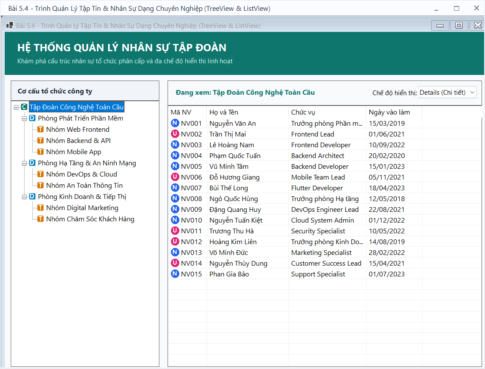
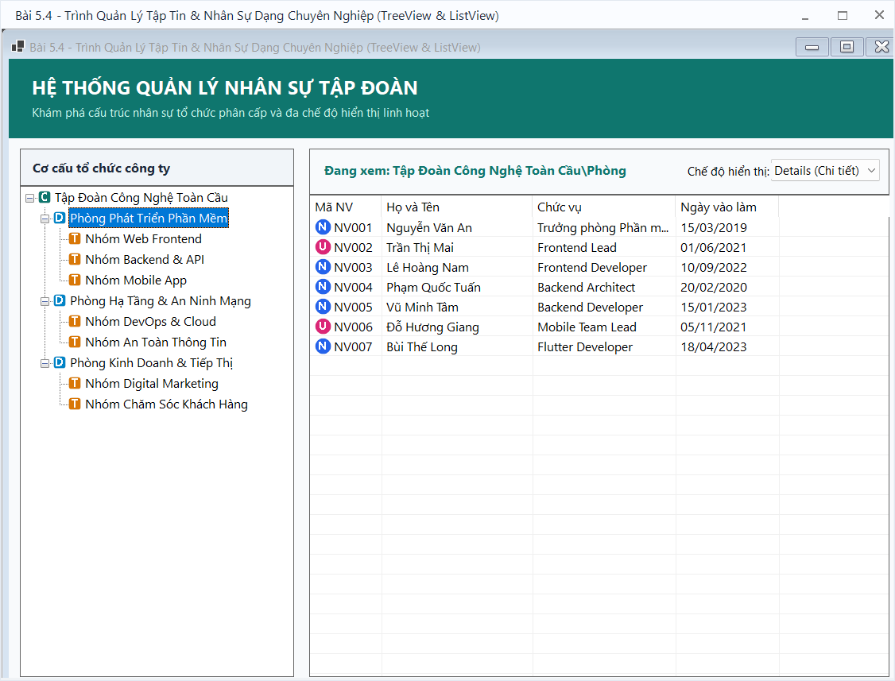
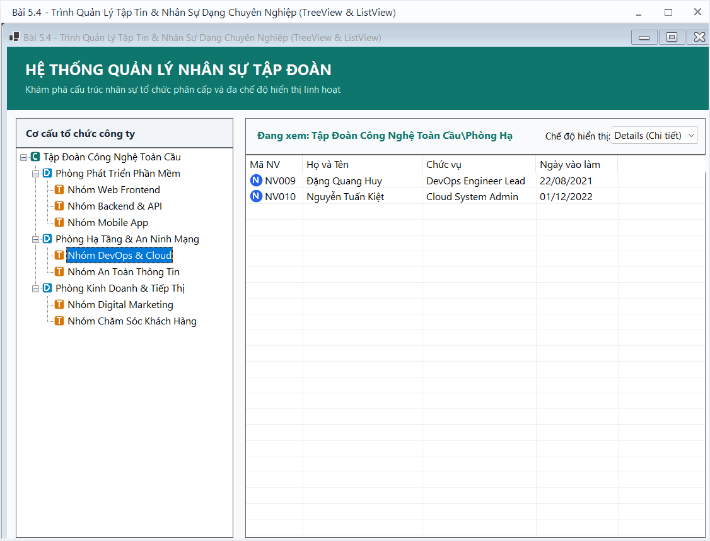
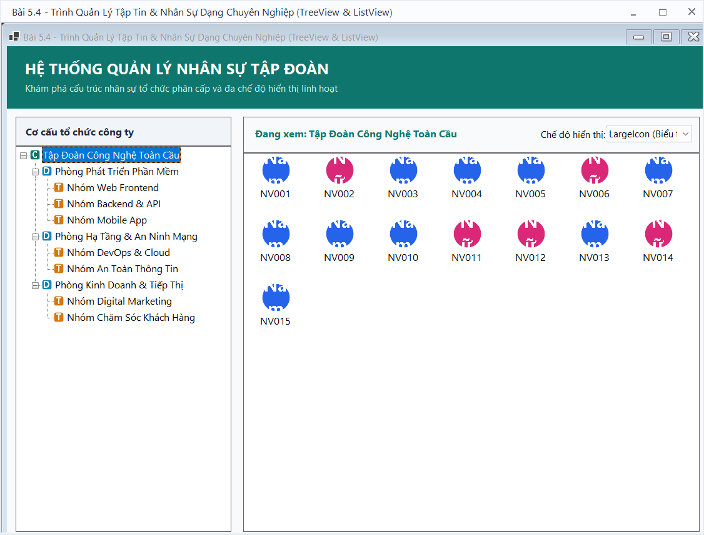
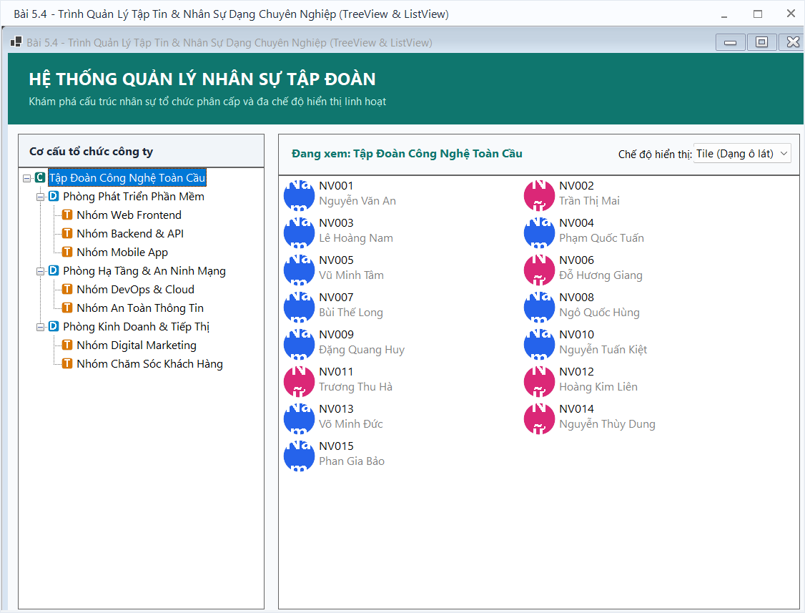

# BÁO CÁO ÔN TẬP THỰC HÀNH WINDOWS FORMS

## THÔNG TIN SINH VIÊN
- **Họ và tên:** [Nguyễn Hải Nam]
- **Mã số sinh viên:** [24810310617]
- **Lớp:** D19CNPM3
- **Tên môn học:** Lập trình C# / Windows Forms (.NET 10)

---

## BÀI TẬP: BÀI 5.4 - TRÌNH QUẢN LÝ TẬP TIN & NHÂN SỰ DẠNG CHUYÊN NGHIỆP (TREEVIEW & LISTVIEW)

### 1. Mục tiêu và Yêu cầu đề bài
- **Mục tiêu:** Sử dụng kết hợp `TreeView` để phân cấp dữ liệu cơ cấu tổ chức (Công ty $\rightarrow$ Phòng ban $\rightarrow$ Nhóm) và `ListView` để hiển thị danh sách chi tiết nhân sự ở nhiều chế độ xem (`Details`, `LargeIcon`, `SmallIcon`, `Tile`, `List`).
- **Yêu cầu chức năng:**
  1. `SplitContainer`:
     - Bên trái: `TreeView` (`tvDepartments`) hiển thị cây phân cấp đa tầng của công ty.
     - Bên phải: `ListView` (`lsvEmployees`) hiển thị danh sách nhân viên tương ứng với Node đang được chọn trên cây.
  2. `ImageList`: Chứa biểu tượng icon cho từng cấp node trên `TreeView` và avatar giới tính/chức vụ cho `ListView`.
  3. `ComboBox` (`cboViewMode`): Cho phép chuyển đổi linh hoạt 5 chế độ hiển thị của `ListView` (`Details`, `LargeIcon`, `SmallIcon`, `Tile`, `List`).
  4. Ở chế độ `Details`, `ListView` hiển thị đầy đủ các cột: Mã NV, Họ Tên, Chức vụ, Ngày vào làm.
  5. Tự động tính toán và hiển thị vị trí hiện tại cũng như số lượng nhân sự trên `StatusStrip`.

---

### 2. Kết quả Thực hành & Hình ảnh Minh họa

#### 2.1. Giao diện chính ban đầu
Cây phân cấp cơ cấu tổ chức bên trái và danh sách toàn bộ nhân sự toàn công ty ở chế độ Details bên phải.

#### 2.2. Lọc nhân sự theo Phòng ban
Khi chọn node "Phòng Phát Triển Phần Mềm", `ListView` lọc và chỉ hiển thị các nhân sự trực thuộc phòng ban này và các nhóm con:

#### 2.3. Lọc nhân sự theo Nhóm chuyên môn
Khi chọn node "Nhóm DevOps & Cloud", danh sách nhân sự thu hẹp chính xác theo phạm vi nhóm:

#### 2.4. Chuyển đổi sang chế độ LargeIcon (Biểu tượng lớn)
Đổi chế độ xem trên ComboBox sang LargeIcon, các nhân sự được hiển thị dưới dạng card lớn kèm icon trực quan:

#### 2.5. Chuyển đổi sang chế độ Tile (Dạng ô lát)
Chế độ Tile kết hợp biểu tượng và thông tin chi tiết của nhân sự trên cùng một ô:

